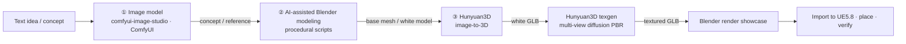
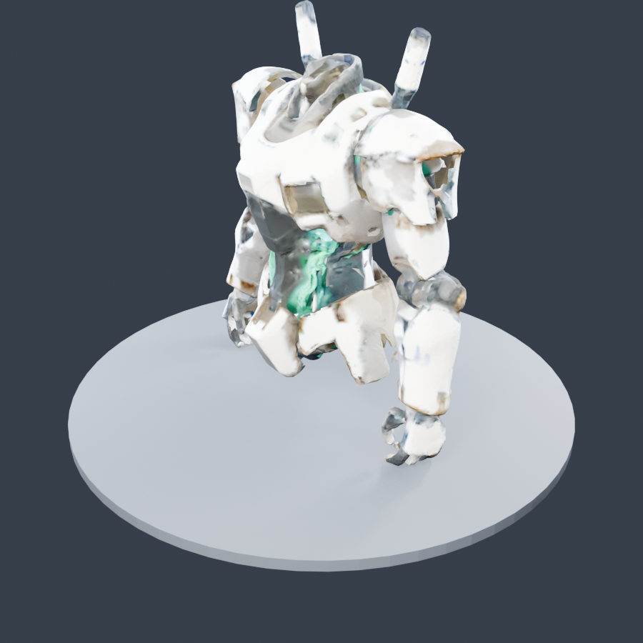
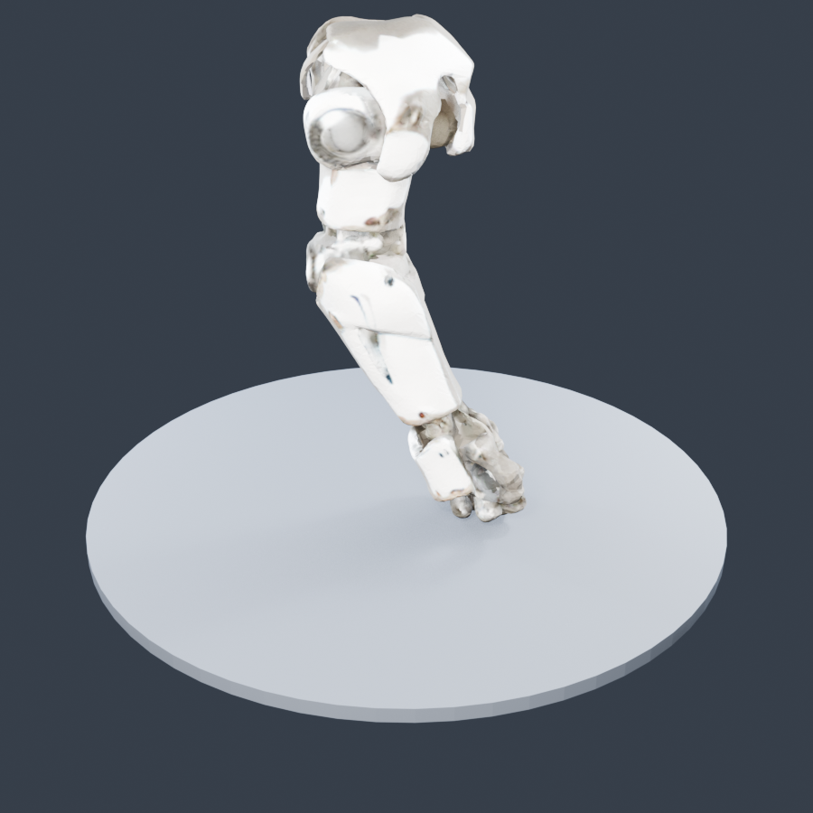
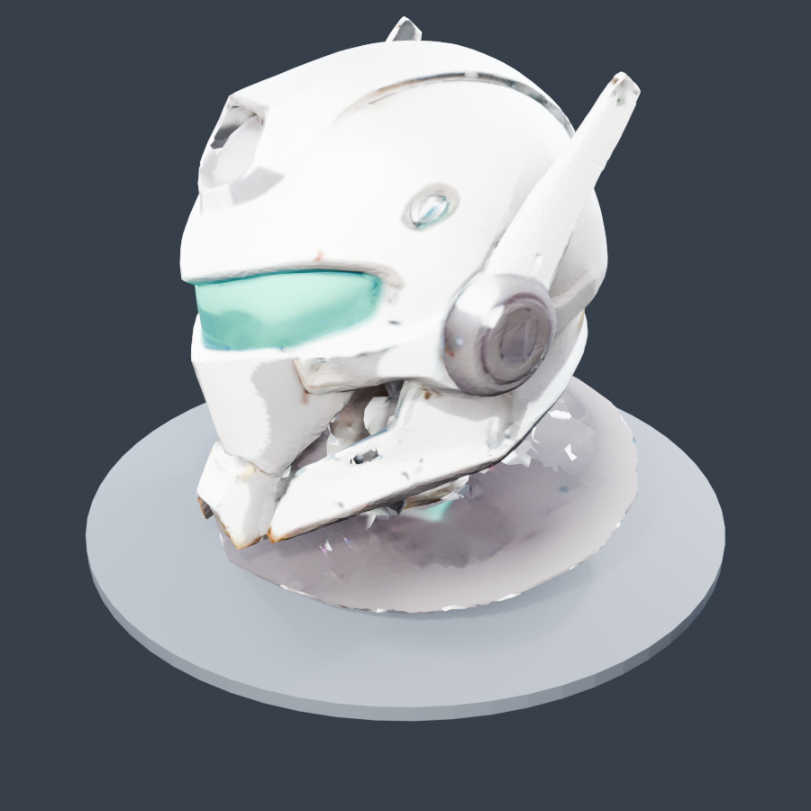
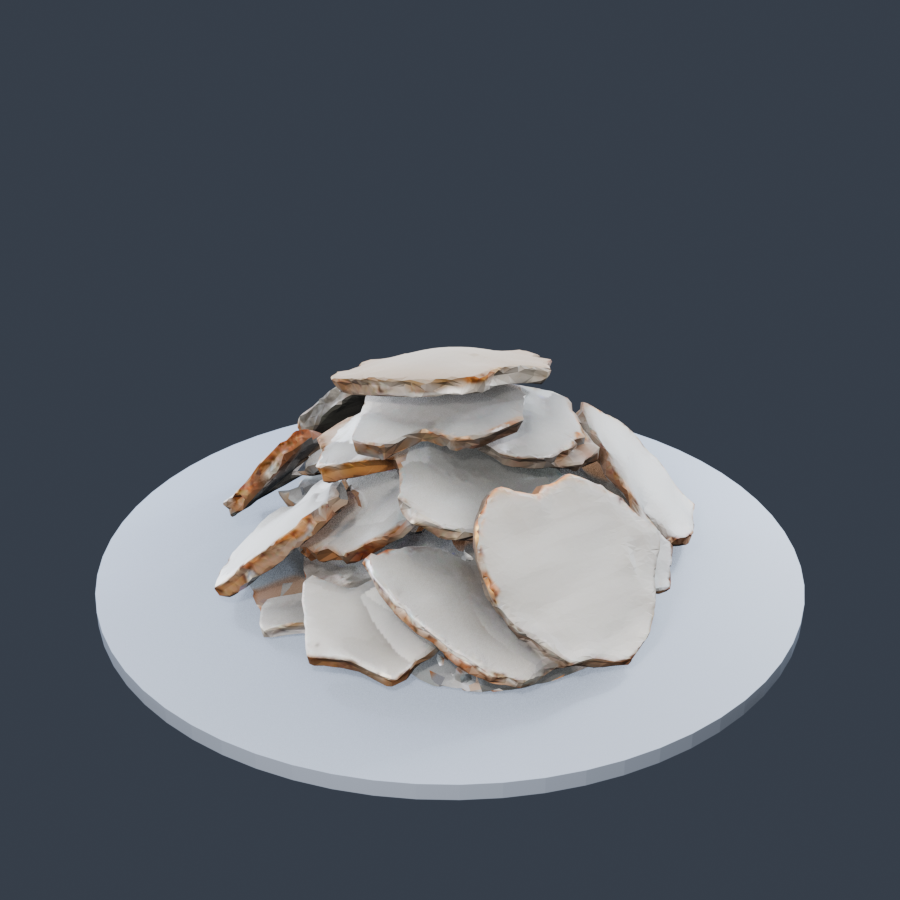

# Ember Protocol

> [简体中文](./README_CN.md) · **English**

> A UE5.8 mech arena game driven by an **AI-powered automated asset pipeline** — from concept art to finely detailed 3D models, the entire process is scripted and reproducible.

[](https://www.unrealengine.com/)
[](https://www.python.org/)
[](https://www.blender.org/)
[](https://github.com/Tencent/Hunyuan3D-2)
[](./LICENSE) · [](./THIRD_PARTY_NOTICES.md)

---

## 🔥 Highlight: AI-Powered Asset Pipeline

The core engineering practice of this project is a pipeline that **automates game art production**. It answers one question: *without an art team, how can one person quickly produce a batch of stylistically consistent, fully textured, high-quality 3D assets?*

The answer is to chain three AI / procedural capabilities into a reproducible pipeline:



### ① Image Models for Textures / Concept Art
Image generation runs through **[comfyui-image-studio](https://github.com/wuuwuu26/comfyui-image-studio)** — a local-first web UI for ComfyUI (Krea 2 / Z-Image / MOSS, tuned for 8 GB GPUs). This project calls it via `tools/easyai.py` (`http://127.0.0.1:7860/api/generate`) to batch-generate concept art and texture materials from text prompts. The 4 mech-wreck concept images (`gen_<name>.png`), posters and seamless textures all came from this step.
- Calling wrapper: `tools/easyai.py` → [comfyui-image-studio](https://github.com/wuuwuu26/comfyui-image-studio)
- Scripts: `tools/gen_posters.py`, `tools/gen_posters2.py`, `tools/gen_textures.py`, `tools/comfy_gen_asset.py`, `tools/comfy_gen_batch.py`, `tools/comfy_gen_mechwreck.py`, `tools/generate_flux.py`
- Texture generation: `tools/gen_coolant_tex.py`, `tools/gen_plasma_tex.py`, `tools/make_*_texture.py`

### ② AI-Assisted Blender Modeling
**Parametric scripts** instead of hand-modeling: change one number to get a new mech variant, with naming, sockets, units, UVs and LODs kept automatically consistent. 51 assets were produced this way — player chassis, 22 modules, 6 enemies, props and environment pieces.
- Library & build scripts: `tools/blender/robotlib.py`, `build_chassis.py`, `build_modules.py`, `build_enemies.py`, `build_props.py`, `build_all.py` (full rebuild ~90 s)
- This solves asset *quantity and consistency*; the *quality ceiling* is handled by the next AI stage.

### ③ Hunyuan3D for Fine 3D Models
Tencent **Hunyuan3D** converts concept art into 3D, then its **texgen** (multi-view diffusion) bakes full-angle PBR textures — overcoming the old "projected textures only work from the front" limitation.
- Image-to-3D + batch: `tools/hy3d_batch.py`, `tools/hy3d_texture_batch.py`
- texgen batch: `tools/texgen_batch2.py`, `tools/fix_texgen_black.py`
- Showcase rendering: `tools/blender/show_asset.py`
- One-command end-to-end pipeline: `tools/mechwreck_pipeline.py`
- **Every asset gets a Blender-rendered textured showcase image** (see `docs/gen3d_shots/`)

> 📖 **Full workflow, pitfalls and measured data: [docs/AI自动化资产工作流.md](./docs/AI自动化资产工作流.md)** (Chinese)

**Textured showcase examples** (`docs/gen3d_shots/`, AI gen → Hunyuan3D → texgen → Blender render):

| Wrecked Mech Torso | Severed Mech Arm | Abandoned Mech Head | Armor Debris |
|:---:|:---:|:---:|:---:|
|  |  |  |  |

---

## 🎮 The Game

The game lives in `ue/` (a UE 5.8 C++ project) and is a complete playable loop:

- **Launch**: double-click `ue/启动游戏.bat`
- **Goal**: clear all 5 enemy mechs in the arena (remaining count at top-right)
- **Result**: wipe all → "Mission Complete" (time / salvage / kills), Enter to redeploy

### Controls

| Action | Keyboard / Mouse | Gamepad |
|---|---|---|
| Move | WASD | Left stick |
| Look | Mouse | Right stick |
| Fire | Left mouse | RT |
| Dash | Space | LT / A |
| Workshop | M | Y / Start |
| Switch mech | 1 / 2 / 3 | D-pad ←→ / RB |
| Confirm / Back | Enter / Esc | A / B |

### Core Mechanics

- **Part damage**: shoot off limbs for more salvage (but enemies last longer), or hit the core for a quick kill
- **Heat constraint**: sustained fire overheats and locks for 2 s — forcing you to plan your output rhythm
- **3 mechs + 22 modules**: 9 slots with live constraints, loadouts change your playstyle

### Core-Loop Prototype

`prototype/core_loop_prototype.html` is an experimental prototype you can open directly in a browser — a 10-minute test of whether the "part damage + heat constraint + three-mech tradeoff" loop is fun, before installing a 100 GB engine.

---

## 📁 Repository Structure

```
robot_game/
├─ README.md                      This file (English, homepage)
├─ README_CN.md                   Chinese version
├─ LICENSE                        MIT License
├─ docs/
│  ├─ AI自动化资产工作流.md        ★ Full AI pipeline record (Chinese)
│  ├─ 余火协议_UE5制作计划.md      Full production plan (Chinese)
│  ├─ 余火协议_UE5制作计划.html    Visual version
│  ├─ 迭代报告_2026-10-31_第六十至一百一十九轮.md   Iteration log (Chinese)
│  ├─ gen3d_shots/                 ★ AI→Hunyuan3D textured showcase images
│  ├─ lighting_shots/ / fluid_shots/ / ui_shots/ ...  scene verification
│  └─ ...
├─ prototype/
│  └─ core_loop_prototype.html    Browser core-loop prototype
├─ tools/
│  ├─ blender/                    Blender procedural modeling (51 assets)
│  ├─ mechwreck_pipeline.py        ★ One-command AI pipeline
│  ├─ hy3d_batch.py / hy3d_texture_batch.py            Hunyuan3D batch
│  ├─ texgen_batch2.py / fix_texgen_black.py           PBR texture gen/fix
│  ├─ easyai.py                       caller for comfyui-image-studio (image gen)
│  ├─ comfy_gen_*.py / generate_flux.py                image generation
│  └─ ...
├─ assets/
│  ├─ 资产清单.md                  Full 51-asset list (Chinese)
│  └─ out/                         Generated .fbx / .blend / .glb / previews
├─ art_src/                        Raw art sources
└─ ue/                             Full UE 5.8 project
   ├─ Content/                     Maps / meshes / materials / textures
   ├─ Source/                      C++ gameplay (GAS / part damage / AI / UI)
   ├─ Config/                      Project config
   └─ 启动游戏.bat                 One-click launch
```

---

## 🛠️ Tech Stack

| Area | Tech |
|---|---|
| Engine | Unreal Engine 5.8 (C++ / GAS / ISM fluid replacing Niagara) |
| 3D generation | Hunyuan3D (image-to-3D + texgen multi-view diffusion PBR) |
| Image generation | [comfyui-image-studio](https://github.com/wuuwuu26/comfyui-image-studio) (ComfyUI web UI: Krea 2 / Z-Image / MOSS) |
| Modeling | Blender 5.3 (Python procedural), trimesh |
| Scripting | Python 3.12 (numpy / cv2 / trimesh / PIL) |
| Textures | texgen native PBR (1024), procedural texture generation |

---

## 📌 Notes

This is a personal learning and prototype project demonstrating an AI automated asset workflow in indie game development. The UE content (`.uasset`) are binary assets requiring UE 5.8 to open; a browser prototype is provided in `prototype/` as an alternative experience.

### Licensing

The [MIT License](./LICENSE) covers only the original source code and works authored by this project. Third-party assets are governed by their own terms — see [THIRD_PARTY_NOTICES.md](./THIRD_PARTY_NOTICES.md) for a per-category breakdown (CC0 textures, Hunyuan3D outputs with use restrictions, Unreal Engine EULA, etc.). Commercial third-party models whose redistribution is not permitted (e.g. Cosmos/Leartes) have been removed from this repository.
