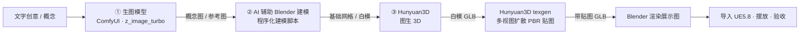
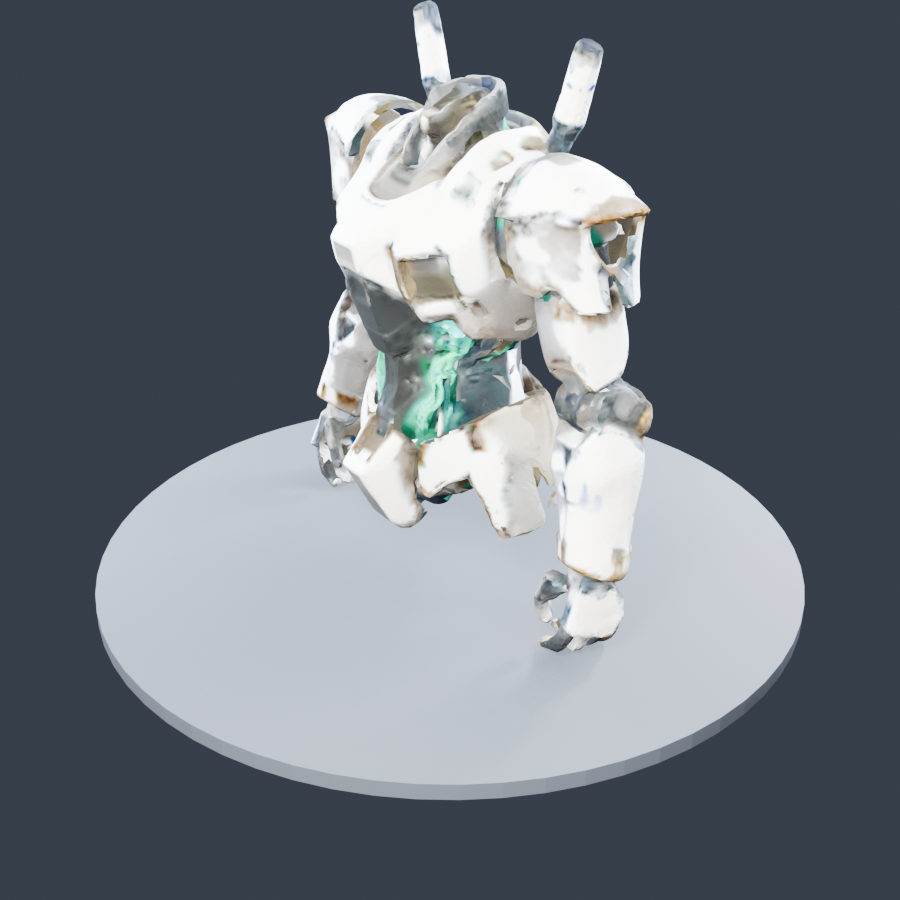
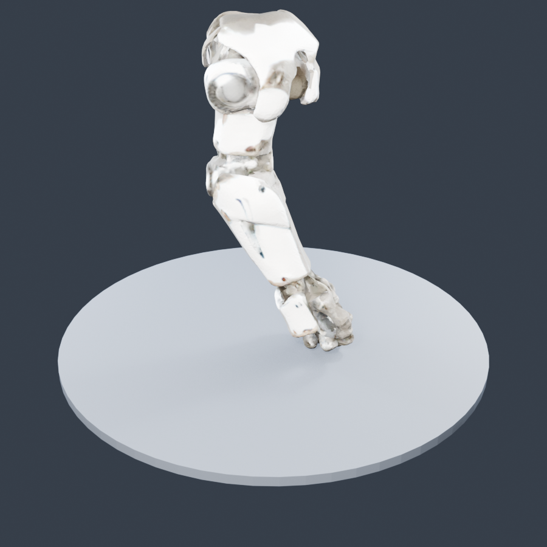
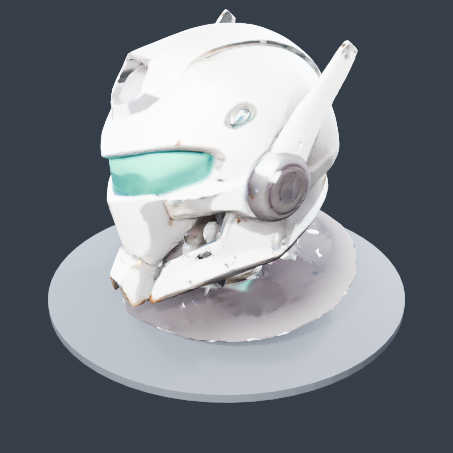
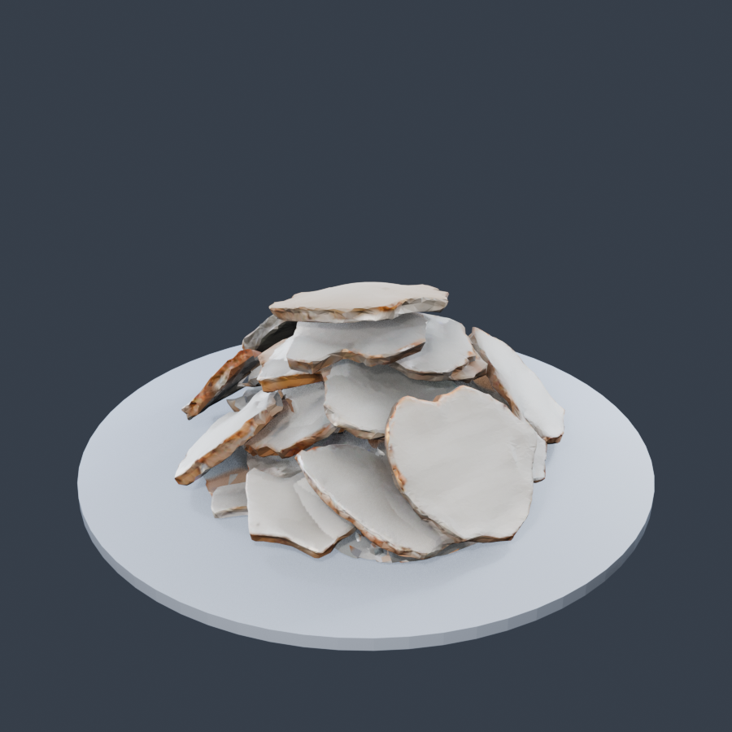

# 余火协议 · Ember Protocol

[English](./README.md) · **简体中文**

> 一个用 **AI 自动化资产管线** 驱动的 UE5.8 机甲竞技场游戏 —— 从概念图到精细 3D 模型，全流程脚本化、可复现。

[](https://www.unrealengine.com/)
[](https://www.python.org/)
[](https://www.blender.org/)
[](https://github.com/Tencent/Hunyuan3D-2)
[](./LICENSE)

---

## 🔥 项目亮点：AI 自动化资产工作流

这个项目最核心的工程实践，是一条**把美术资产生产自动化的流水线**。它回答一个问题：*没有美术团队，一个人怎么快速产出一批风格统一、带完整 PBR 贴图的精细 3D 资产？*

答案是把三段 AI / 程序化能力串成一条可复现的管线：



### ① 生图模型生成贴图 / 概念图
用 **ComfyUI**（`z_image_turbo` / `flux` / `krea2_turbo`）按文本提示批量生成概念图与贴图素材。例如机甲碎骸批次的 4 张概念图（`gen_<name>.png`）就是这一步产出，再作为 Hunyuan3D 的输入。
- 脚本：`tools/comfy_gen_asset.py`、`tools/comfy_gen_batch.py`、`tools/comfy_gen_mechwreck.py`、`tools/generate_flux.py`
- 贴图素材生成：`tools/gen_textures.py`、`tools/gen_coolant_tex.py`、`tools/gen_plasma_tex.py`、`tools/make_*_texture.py` 系列

### ② AI 辅助 Blender 建模
用**参数化脚本**而不是手搓来产出模型：改一个数字就能出新机型，命名、挂点、单位、UV、LOD 全部自动一致。主角机体、22 个模块、6 类敌人、道具与环境构件共 51 个资产由此生成。
- 程序化建模库与构建脚本：`tools/blender/robotlib.py`、`build_chassis.py`、`build_modules.py`、`build_enemies.py`、`build_props.py`、`build_all.py`（全量重建约 90 秒）
- 这套管线解决的是"资产数量与一致性"问题， quality 的上限则交给下一步的 AI 模型。

### ③ Hunyuan3D 生成精细 3D 模型
用腾讯 **Hunyuan3D** 把概念图转成 3D，再用其 **texgen**（多视图扩散）烘焙全角度 PBR 贴图，替代早期"投影贴图只有正面有效"的局限。
- 图生 3D + 批处理：`tools/hy3d_batch.py`、`tools/hy3d_texture_batch.py`
- texgen 贴图批处理：`tools/texgen_batch2.py`、`tools/fix_texgen_black.py`
- 展示图渲染：`tools/blender/show_asset.py`
- 一键串起整条流水线：`tools/mechwreck_pipeline.py`
- **每个资产生成后都有一张 Blender 渲染的带贴图展示图**（见 `docs/gen3d_shots/`）

> 📖 **完整工作流、踩坑与实测数据见 [docs/AI自动化资产工作流.md](./docs/AI自动化资产工作流.md)**。

**带贴图展示图示例**（`docs/gen3d_shots/`，AI 生成 → Hunyuan3D → texgen → Blender 渲染）：

| 破损机甲躯干 | 断裂机械臂 | 废弃机甲头盔 | 装甲碎片堆 |
|:---:|:---:|:---:|:---:|
|  |  |  |  |

---

## 🎮 游戏本体

游戏在 `ue/`（UE 5.8 C++ 工程），是一个可玩的完整循环：

- **启动**：双击 `ue/启动游戏.bat`
- **目标**：肃清竞技场里的 5 台敌机（右上角显示残敌数）
- **结算**：全灭 → "任务完成"（用时/废料/击毁），回车重新部署

### 操作

| 动作 | 键盘鼠标 | 手柄 |
|---|---|---|
| 移动 | WASD | 左摇杆 |
| 视角 | 鼠标 | 右摇杆 |
| 射击 | 鼠标左键 | RT |
| 冲刺 | 空格 | LT / A |
| 改装台 | M | Y / Start |
| 换机体 | 1 / 2 / 3 | 十字键 ←→ / RB |
| 确认 / 返回 | 回车 / Esc | A / B |

### 核心机制

- **部位伤害**：打四肢可拆件（多拿废料但敌人更持久），或直击核心速杀
- **热量约束**：持续射击会过热锁定 2 秒，逼你规划输出节奏
- **三机体 + 22 模块改装**：9 槽位实时约束，换装改变打法

### 节奏原型

`prototype/core_loop_prototype.html` 是一个浏览器直接打开就能玩的实验原型——在装 100GB 引擎之前，先用 10 分钟验证"打部位 + 热量约束 + 三机体取舍"这套核心循环好不好玩。

---

## 📁 仓库结构

```
robot_game/
├─ README.md                      英文版（仓库首页）
├─ README_CN.md                   本文件（简体中文）
├─ LICENSE                        许可证
├─ docs/
│  ├─ AI自动化资产工作流.md        ★ AI 三段式工作流全记录（重点）
│  ├─ 余火协议_UE5制作计划.md      完整制作计划
│  ├─ 余火协议_UE5制作计划.html    可视化版本
│  ├─ 迭代报告_2026-10-31_第六十至一百一十九轮.md   迭代实录
│  ├─ gen3d_shots/                 ★ AI→Hunyuan3D 带贴图展示图
│  ├─ lighting_shots/ / fluid_shots/ / ui_shots/ ...  场景验收截图
│  └─ ...
├─ prototype/
│  └─ core_loop_prototype.html     浏览器核心循环原型
├─ tools/
│  ├─ blender/                     Blender 程序化建模管线（51 资产）
│  ├─ mechwreck_pipeline.py        ★ AI 一键流水线（生图→3D→贴图→展示）
│  ├─ hy3d_batch.py / hy3d_texture_batch.py            Hunyuan3D 批处理
│  ├─ texgen_batch2.py / fix_texgen_black.py           PBR 贴图生成/修复
│  ├─ comfy_gen_*.py / generate_flux.py                生图脚本
│  └─ ...
├─ assets/
│  ├─ 资产清单.md                  51 个资产的完整清单
│  └─ out/                         生成的 .fbx / .blend / .glb / 预览图
├─ art_src/                        原始美术素材
└─ ue/                             UE 5.8 完整工程
   ├─ Content/                     地图 / 网格 / 材质 / 贴图
   ├─ Source/                      C++ 游戏逻辑（GAS / 部位伤害 / AI / UI）
   ├─ Config/                      工程配置
   └─ 启动游戏.bat                 一键启动
```

---

## 🛠️ 技术栈

| 环节 | 工具 / 技术 |
|---|---|
| 游戏引擎 | Unreal Engine 5.8（C++ / GAS / Niagara 替代的 ISM 流体） |
| 3D 生成 | Hunyuan3D（图生 3D + texgen 多视图扩散 PBR 贴图） |
| 生图 | ComfyUI（z_image_turbo / flux / krea2_turbo） |
| 建模 | Blender 5.3（Python 程序化建模）、trimesh |
| 脚本 | Python 3.12（numpy / cv2 / trimesh / PIL） |
| 贴图 | texgen 原生 PBR（1024）、程序化纹理生成 |

---

## 📌 说明

本项目是个人学习与原型验证项目，用于展示 AI 自动化资产工作流在独立游戏开发中的实践。UE 工程内容（`.uasset`）为二进制资产，需要用 UE 5.8 打开；无法在浏览器直接运行的部分已提供 `prototype/` 原型作为替代体验。

第三方资产（PolyHaven / Quixel / Cosmos 等）的版权归各自所有者所有，见 `docs/` 内相关清单。
